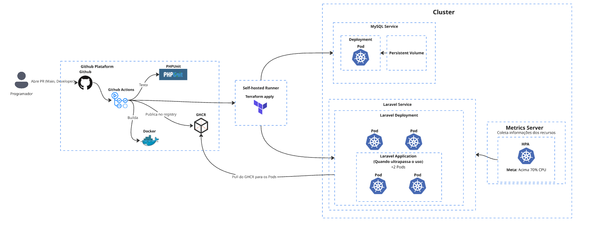

# TechChallenge API
Serviço de Ordem de Serviço da oficina (fase 4 do POS Tech Challenge), construído com Laravel 13, JWT e MySQL, com ambiente local via Docker Compose, deploy no EKS e documentação OpenAPI.

## Descrição da solução e papel na fase 4

Na fase 4 a oficina passou a operar como um conjunto de microsserviços, cada um com repositório, infraestrutura e banco próprios. Este repositório é o **serviço de Ordem de Serviço (OS Service)**: cadastro de clientes, veículos, peças e serviços, abertura da O.S., orçamento e **dono do status da O.S.** Ele conversa com os outros serviços só por API e mensageria, sem acessar o banco de nenhum deles.

| Serviço | Repositório | Responsabilidade | Banco |
|---|---|---|---|
| OS Service (este) | `tech-challenge-application` | Autenticação JWT, cadastros, abertura da O.S., orçamento, status e notificações | RDS MySQL (`techchallenge-rds`) |
| Billing / Pagamento | [`tech-challenge-payment`](https://github.com/eduNsantos/tech-challenge-payment) | Cobrança via Mercado Pago, orquestrada por Saga (Step Functions) | DynamoDB |
| Execução | `tech-challenge-services-ms` | Fila de execução, início e fim de cada serviço da O.S. | RDS MySQL próprio (`services_ms`) |

Como este serviço se comunica com os demais:

- **Pagamento (síncrono + callback):** o envio do orçamento chama `POST /orders` no payment-service, que devolve o link de pagamento e o resultado por callback. Veja [Integração com o payment-service](#integração-com-o-payment-service).
- **Execução (assíncrono, SQS FIFO + outbox):** criação e mudanças de status da O.S. vão para o Services MS por filas. Cada início e fim de serviço, e o fim da execução, voltam pela fila `service-order-execution.fifo`. Veja [Integração com o microsserviço de serviços](#integração-com-o-microsserviço-de-serviços).

Execução e deploy:

- Local: Docker Compose (veja `Início rápido (do zero)` e `Configuração do ambiente`).
- Produção: EKS, com imagem publicada no GHCR por este repositório e deploy feito pelo workflow `deploy-eks.yml` do `tech-challenge-kubernetes`. As Lambdas de outbox e de consumo rodam via Bref (veja [Lambdas](#lambdas-publisher-e-consumer)).
- Observabilidade: New Relic, mantido da fase 3.
- Kubernetes local: o ambiente Minikube + Terraform da fase 2 continua disponível para validar manifestos (veja `Ambiente Kubernetes (Minikube + Terraform)`).

## Desenho da arquitetura

```
                 Cliente / Atendente ──JWT──> OS Service (este repo, EKS) ──> RDS MySQL
                                                │        ▲
             POST /orders + callback/notification│        │ POST /api/payment/{notification,callback}
                                                ▼        │
                                   payment-service (API Gateway → Step Functions/Saga → Mercado Pago, DynamoDB)

 OS Service ── outbox ──> λ postech-outbox-publisher ──> SQS service-orders-created.fifo ───────┐
                                                     └─> SQS service-order-status-changed.fifo ─┤──> Services MS
 OS Service <── λ postech-execution-consumer <── SQS service-order-execution.fifo <─────────────┘
```

Pipeline de build e deploy em Kubernetes herdado da fase 2 (GitHub Actions → GHCR → cluster):



## Saga da O.S.

A O.S. passa por três serviços: abertura e orçamento (este), pagamento (payment-service) e execução (Services MS). A consistência entre eles segue o Saga Pattern em dois níveis:

- **Entre os serviços, coreografia.** Cada serviço reage a eventos e callbacks dos outros, sem um coordenador central. A O.S. tem um único dono do status (este serviço), então não há decisão a centralizar. As filas FIFO por O.S. e a outbox garantem ordem e entrega sem acoplar os deploys.
- **Dentro do pagamento, orquestração.** O payment-service coordena seus passos com Step Functions, porque o Mercado Pago não emite eventos de saga e alguém precisa controlar prazo, novas tentativas e cancelamento. Veja [`docs/saga-architecture.md`](https://github.com/eduNsantos/tech-challenge-payment/blob/main/docs/saga-architecture.md) no repositório do payment.

### Passos e tratamento de falha

| # | Passo | Serviço | Tipo | Se falhar |
|---|---|---|---|---|
| 1 | Abrir a O.S. | este | Compensável | Transação local: O.S., serviços e outbox são gravados juntos ou nada é gravado |
| 2 | Enviar o orçamento e gerar a cobrança | este + payment | Compensável | Falha no payment-service ou estoque insuficiente desfaz a operação; nenhuma cobrança fica pendente |
| 3 | Pagamento | payment | **Pivô** | `REJECTED` ou `EXPIRED`: a O.S. volta para `em_diagnostico`, sem baixa de estoque, e um novo orçamento abre outra cobrança. Dentro do payment, falta de pagamento no prazo cancela a cobrança e falha permanente vai para a DLQ |
| 4 | Aprovar, baixar estoque e enviar para execução | este | Repetível | Mesma transação do status; o evento sai pela outbox até ser entregue |
| 5 | Executar os serviços | Services MS | Repetível | Nova tentativa automática (abaixo) |
| 6 | Finalizar a O.S. | este | Repetível | Mesma estratégia do passo 5 |

### Por que a execução não é compensada

O pagamento (passo 3) é o pivô da saga: antes dele, toda falha é desfeita; depois dele, o cliente já pagou e os passos seguintes precisam chegar ao fim. Compensar a execução significaria estornar o pagamento e devolver peças já baixadas por uma falha técnica. Por isso os passos 4 a 6 usam **recuperação para frente**: são repetidos até concluir.

- As mensagens com falha voltam à fila e, após 3 recebimentos, vão para a DLQ.
- A Lambda `services-ms-dlq-redriver` devolve a mensagem da DLQ para a fila a cada 15 minutos, até 4 vezes. Com os padrões, são 15 tentativas em cerca de 1 hora. Isso cobre falhas temporárias como banco indisponível ou deploy fora de ordem.
- Reenviar é seguro: os consumidores são idempotentes (`processed_messages` e `sequence`), e eventos de status antigos são ignorados.
- Esgotadas as tentativas, a mensagem fica na DLQ para análise manual e o Services MS registra a métrica `messaging.dead_letter.redrives{outcome=exhausted}`. A fila FIFO segura as mensagens seguintes da mesma O.S., então a ordem não se perde.

Fora do escopo: uma falha de negócio na execução (por exemplo, o reparo não poder ser feito) não tem evento próprio. Hoje o atendente trata manualmente, alterando o status da O.S.

### Cobertura por testes

Os cenários `@compensacao`, `@rollback` e `@idempotencia` de `tests/Bdd/features/saga_ordem_de_servico.feature` exercitam os passos 1 a 3 e 6 deste serviço. Os cenários da saga do pagamento ficam em `src/features/saga_pagamento.feature` no payment-service. Veja [Testes BDD](#testes-bdd-fluxo-completo-da-os).

## Stack
- PHP 8.4
- Laravel 13
- MySQL 8
- JWT para autenticação
- Docker Compose
- Swagger UI para visualização da documentação


## Pré-requisitos
Antes de iniciar, tenha instalado na máquina:

- Docker
- Docker Compose

## Início rápido (do zero)

Se você quer rodar o projeto com o mínimo de passos, execute:

```bash
make bootstrap
```

Depois, acesse:

- API: `http://localhost:8080`
- Swagger: `http://localhost:8082`

Para parar tudo:

```bash
docker compose down
```

## Serviços disponíveis

Ao subir o ambiente, os serviços ficam disponíveis em:

- API Laravel: `http://localhost:8080`
- Swagger UI: `http://localhost:8082`
- MySQL: `localhost:3308`

## Configuração do ambiente

### 1. Copie o arquivo de ambiente

```bash
cp .env.example .env
```

### 2. Revise as variáveis do banco

O projeto já vem configurado para usar o serviço `db` do Docker Compose. No `.env`, valide ao menos estes campos:

```env
DB_CONNECTION=mysql
DB_HOST=db
DB_PORT=3306
DB_DATABASE=techchallenge
DB_USERNAME=techchallenge
DB_PASSWORD=

JWT_SECRET=
```

Se quiser evitar inconsistência no MySQL, mantenha `DB_PASSWORD` preenchido com o mesmo valor usado no container.

Para gerar o JWT_SECRET precisa ter ao menos 256 bytes. Para facilitar utilize este comando e copie o output:

```
docker compose run --rm app-php php artisan jwt:secret
```

### 3. Suba os containers

```bash
docker compose up -d --build
```

### 4. Instale as dependências do PHP

```bash
docker compose run --rm app-php composer install
```

### 5. Gere a chave da aplicação
```bash
docker compose run --rm app-php php artisan key:generate
```

### 6. Rode as migrations
```bash
docker compose run --rm app-php php artisan migrate
```

## Como executar no dia a dia

Para iniciar o ambiente:

```bash
docker compose up -d
```

## Documentação da API

O contrato da API está no arquivo `openapi.yaml`.

Para visualizar a documentação no navegador, suba o serviço e acesse:

```text
http://localhost:8082
```
## Testes e qualidade de código

O projeto usa um `Makefile` para centralizar os comandos de teste, coverage e análise estática. Certifique-se de ter o `make` instalado na máquina.

### Referência rápida

| Comando | Descrição |
|---|---|
| `make help` | Lista todos os targets disponíveis |
| `make test` | Roda a suíte de testes **sem** gerar relatório de coverage (mais rápido) |
| `make bdd` | Roda os testes BDD (Behat) do fluxo completo da O.S. |
| `make coverage` | Roda os testes e gera `coverage.xml` via PCOV |
| `make scan` | Roda o SonarQube Scanner (requer `SONAR_TOKEN` e SonarQube em pé) |
| `make ci` | `coverage` + `scan` em sequência — ideal para pipelines de CI |
| `make all` | `up` + `coverage` + `scan` |
| `make up` | Sobe os containers de desenvolvimento em background |
| `make down` | Para e remove os containers de desenvolvimento |
| `make lint` | Formata o código com Laravel Pint |
| `make seed-dev` | Popula o banco de dados com informações principais |

### Rodar os testes

```bash
# Execução rápida, sem relatório de cobertura
make test

# Com geração de coverage.xml
make coverage
```

Os testes rodam dentro do container `app-test` definido em `docker-compose.test.yml`, usando um banco MySQL efêmero em tmpfs.

### Testes BDD (fluxo completo da O.S.)

```bash
make bdd                  # ou: vendor/bin/behat
```

Cenários em Gherkin (português) em `tests/Bdd/features/saga_ordem_de_servico.feature`, executados com Behat.
Eles cobrem a O.S. da abertura à entrega, passando pelo payment-service e pelo services-ms (simulados), além de
compensação, rollback e idempotência da Saga. Usam SQLite em memória, não precisam do MySQL e também rodam no CI.
Detalhes, cenários da SAGA do payment-service e evidências: [`docs/Fase4/testes-bdd.md`](docs/Fase4/testes-bdd.md).

### Análise de cobertura com SonarQube

O SonarQube é configurado no `docker-compose.yml`. Na primeira execução, acesse `http://localhost:9000` para criar um projeto e gerar um token de acesso.

```bash
# Gera coverage e envia para o SonarQube
SONAR_TOKEN=sqa_xxxx make ci
```

O `SONAR_TOKEN` também pode ser exportado no shell para não precisar repeti-lo:

```bash
export SONAR_TOKEN=sqa_xxxx
make ci
```

## Observações

- O container `app-php` publica a aplicação na porta `8080` usando `php artisan serve`.
- O Swagger UI lê diretamente o arquivo `openapi.yaml` do projeto.
- O banco MySQL é exposto localmente na porta `3308`.

## Integração com o payment-service

O envio de orçamento chama o [tech-challenge-payment](https://github.com/eduNsantos/tech-challenge-payment):

1. `POST {PAYMENT_SERVICE_URL}/orders` com `callback_url` e `notification_url` (montados a partir do `APP_URL`)
2. o link de pagamento volta em `POST /api/payment/notification` → e-mail do orçamento ao cliente
3. o resultado volta em `POST /api/payment/callback/{token}` → `PAID` aprova; qualquer outro status recusa

| Variável | Para que serve | Em produção (EKS) |
|---|---|---|
| `PAYMENT_SERVICE_URL` | Base da API do payment-service | Descoberta no deploy pelo nome da API Gateway `payment-service-api` |
| `APP_URL` | URL pública do app (links do e-mail, `callback_url`, `notification_url`) | Hostname do ELB do Service `postech-app` |
| `PAYMENT_CALLBACK_BASE_URL` | Sobrescreve a base do `callback_url`/`notification_url` (opcional) | — |

As duas primeiras são resolvidas pelo job `rollout` do `deploy-eks.yml` no repo **tech-challenge-kubernetes**, que é quem implanta este app no EKS. Para fixar um valor, defina `PAYMENT_SERVICE_URL` ou `APP_URL` em *Settings → Variables* daquele repo.

**Ordem de deploy:** payment-service primeiro, depois o app. Se o payment-service for recriado, basta rodar o deploy do app de novo. Se o ELB mudar, as cobranças já abertas perdem o retorno, porque a URL antiga fica gravada nelas.

## Ambiente Kubernetes (Minikube + Terraform)

Além do Docker Compose (fluxo padrão do dia a dia), o projeto tem um segundo ambiente que roda a aplicação inteira dentro de um cluster Kubernetes local, via **Minikube**. É o ambiente usado sempre que você mexe em algo que impacta o deploy em si (Deployments, Services, HPA, ConfigMaps, Secrets).

Todo o provisionamento — desde o namespace até o Job de migration — é feito por um único diretório `infra/` no Terraform, usando o provider `kubernetes` (e `helm`, só para o metrics-server). Não existem `kubectl apply` soltos nem `local-exec` chamando o cluster por fora: cada manifest é um resource do Terraform, e o state fica todo em `infra/`.

### Papel de cada peça

| Peça | Papel |
|---|---|
| **Minikube** | Cria o cluster Kubernetes de um nó rodando localmente (por padrão, como um container Docker via seu próprio driver). |
| **Terraform** (`infra/`) | Orquestra **toda** a stack dentro do cluster: namespace, ConfigMaps, Secrets, MySQL (Deployment + Service + PV/PVC), Job de migration, Deployment/Service/HPA da aplicação, Deployment/Service do Swagger, e o `metrics-server` via Helm (necessário para o HPA). Cada peça é um resource nativo (`kubernetes_namespace_v1`, `kubernetes_deployment_v1`, `kubernetes_secret_v1` etc.) — nada é aplicado via shell. |
| **GitHub Actions** | `build-ghcr.yml` builda e publica a imagem no GHCR. `deploy-minikube.yml` roda `terraform apply` em um runner self-hosted com o Minikube já em pé, passando os segredos como variáveis do Terraform (`TF_VAR_*`). |

### Docker Compose vs Minikube — quando usar cada um

| | Docker Compose | Minikube + Kubernetes |
|---|---|---|
| Uso principal | Dia a dia, desenvolvimento | Validar o comportamento em Kubernetes (Deployments, HPA, Services) |
| Orquestração | `docker-compose.yml` | Resources Terraform (`kubernetes_*`) |
| Banco | Container `db` | Deployment MySQL dentro do cluster |
| Acesso externo | Portas mapeadas direto | Services + `minikube tunnel` |
| Escala | Manual | HPA (autoscaling automático) |

### Pré-requisitos

- Docker
- [Minikube](https://minikube.sigs.k8s.io/docs/start/)
- `kubectl`
- Terraform >= 1.6
- Um Personal Access Token do GitHub (classic) com escopo `read:packages`, para puxar a imagem do GHCR

Para o deploy por manifestos (`deploy-minikube.yml` ou `kubectl apply`), crie
previamente o Secret `ghcr-secret` no namespace `postech`, fora do repositório.
Por exemplo, usando um arquivo Docker config protegido que contenha somente as
credenciais necessárias ao GHCR:

```bash
kubectl create namespace postech --dry-run=client -o yaml | kubectl apply -f -
kubectl create secret generic ghcr-secret -n postech \
  --type=kubernetes.io/dockerconfigjson \
  --from-file=.dockerconfigjson=/caminho/seguro/config.json
```

O arquivo deve conter a autenticação no campo `auths` para `ghcr.io`; uma
configuração que dependa apenas de um credential helper não é suficiente.
Não versione o arquivo Docker config nem um manifesto contendo credenciais.
O workflow de deploy exige que o Secret já exista e não o substitui.

### Passo a passo

**1. Suba o cluster**

Via Makefile: `make minikube-start`

Ou manualmente:
```bash
minikube start
kubectl config use-context minikube
```

**2. Configure as variáveis sensíveis**

`app_key`, `db_password` e `jwt_secret` **não precisam ser gerados de novo** — são os mesmos valores que já estão no seu `.env` (gerados no fluxo de Docker Compose acima, via `make bootstrap` ou os passos manuais 2 e 5). Reaproveitar evita, por exemplo, que o JWT emitido pela API do Compose seja invalidado ao rodar no Kubernetes com uma chave diferente:

```bash
grep -E '^(APP_KEY|DB_PASSWORD|JWT_SECRET)=' .env
```

Crie `infra/terraform.tfvars` com esses valores (está no `.gitignore` — nunca commitar com dados reais):

```hcl
app_key       = "base64:COPIE_DO_SEU_.ENV"
db_password   = "COPIE_DO_SEU_.ENV"
jwt_secret    = "COPIE_DO_SEU_.ENV"

ghcr_username = "SEU_USUARIO_GITHUB"
ghcr_token    = "SEU_TOKEN_COM_read:packages"

# Opcionais — já têm default em variables.tf, só defina se quiser sobrescrever:
# ghcr_email    = "SEU_EMAIL"
# mail_username = "SEU_EMAIL_SMTP"
# mail_password = "SUA_SENHA_DE_APP"

```

**3. Aplique com Terraform**

Via `Makefile` (recomendado — já valida se `terraform.tfvars` existe):

```bash
make infra-init
make infra-apply
# ou os dois passos de uma vez, incluindo o minikube start: make k8s-up
```

Ou manualmente:

```bash
cd infra
terraform init
terraform apply
cd ..
```

Isso cria o namespace, ConfigMaps, Secrets, MySQL, roda o Job de migration e sobe a aplicação e o Swagger — nessa ordem, controlada pelas dependências entre os resources.

### Acessando a documentação (Swagger)

Como o Service da app e o do Swagger são `LoadBalancer`, no Minikube eles só
recebem IP externo enquanto o túnel estiver ativo. Em um terminal separado,
deixe rodando:

```bash
make k8s-tunnel
```

Em outro terminal, com o túnel ativo, obtenha as URLs:

```bash
make k8s-urls
```

Isso imprime:

```bash
App:     http://127.0.0.1:xxxxx
Swagger: http://127.0.0.1:xxxxx
```

Abra a URL do **Swagger** no navegador para acessar a documentação interativa
da API (`openapi.yaml` da raiz do projeto).

**Para desligar tudo:**

Via Makefile: `make k8s-down`

Ou manualmente:
```bash
cd infra && terraform destroy && cd ..
minikube stop
```

### Atualizando a aplicação (nova imagem)

Como a tag da imagem (`image_tag`) faz parte do nome do Deployment e do Job de migration, basta rodar `terraform apply` de novo com uma tag nova para que o Terraform detecte a mudança, recrie o Job de migration e faça o rollout do Deployment automaticamente — sem precisar de `kubectl rollout restart` manual:

```bash
make infra-apply IMAGE_TAG=sha-abc1234
```

### Referência rápida (make)

| Comando | Descrição |
|---|---|
| `make minikube-start` | Sobe o cluster Minikube e seleciona o context |
| `make infra-init` | `terraform init` em `infra/` (valida se `terraform.tfvars` existe) |
| `make infra-plan` | `terraform plan` (aceita `IMAGE_TAG=<tag>`) |
| `make infra-apply` | `terraform apply` (aceita `IMAGE_TAG=<tag>`) |
| `make infra-destroy` | Remove toda a stack provisionada pelo Terraform |
| `make infra-reset` | Limpeza forçada (namespace + PV + dados do MySQL no host) — usar quando o cluster ficar num estado inconsistente com o Terraform |
| `make k8s-up` | `minikube-start` + `infra-init` + `infra-apply` em sequência |
| `make k8s-down` | `infra-destroy` + `minikube-stop` |
| `make k8s-status` | Mostra pods e services do namespace |
| `make k8s-urls` | Exibe as URLs de acesso (requer `minikube tunnel` rodando) |
| `make k8s-tunnel` | Abre o túnel do Minikube (`minikube tunnel`, roda em foreground)

Os logs do container da aplicação mostram os eventos Laravel gravados em
`storage/logs/laravel.log`; as linhas de conexão HTTP do `artisan serve` são
suprimidas. Para acompanhar os logs no Kubernetes:

```bash
kubectl logs -n postech -l app=postech-app -c app -f --prefix=true
```

## Integração com o microsserviço de serviços

A aplicação é dona do status da O.S. Com `SERVICES_MS_ENABLED=true`:

- A criação da O.S. grava `ServiceOrderCreated` na outbox, na mesma transação da O.S. e de seus serviços. O contrato transporta somente os serviços, sem peças/itens.
- Toda mudança de status gravada pelo repositório grava `ServiceOrderStatusChanged` na outbox, na mesma transação. Isso inclui aprovação, rejeição e alteração manual. O campo `sequence` é o id da linha na outbox. O MS usa esse valor para descartar eventos antigos.
- A Lambda `postech-outbox-publisher` (`App\Lambda\PublishOutboxHandler`, agendada pelo EventBridge a cada minuto) envia os eventos de criação para `service-orders-created.fifo` e os de status para `service-order-status-changed.fifo`.
- A Lambda `postech-execution-consumer` (`App\Lambda\ServiceOrderExecutionHandler`, acionada pela fila) consome `service-order-execution.fifo`. Essa fila recebe quatro tipos de evento, todos com o id da O.S. como grupo FIFO:

  | Evento | Quando o MS envia | O que a aplicação faz |
  |---|---|---|
  | `ServiceOrderServiceStarted` | Todo início de serviço | Grava `started_at` e `started_user_id` em `service_order_services` |
  | `ServiceOrderServiceFinished` | Todo fim de serviço | Grava `finished_at` e `finished_user_id` em `service_order_services` |
  | `ServiceOrderExecutionStarted` | Primeiro início da O.S. | Nada (a O.S. já está em `em_execucao`) |
  | `ServiceOrderExecutionFinished` | Fim do último serviço | Muda a O.S. para `finalizada` (regras abaixo) |

  Os eventos de serviço não alteram o status. O serviço é localizado por `service_order_service_id`, que é o mesmo id de `service_order_services` enviado no `ServiceOrderCreated`. Se o serviço não existir mais na O.S., o evento é ignorado com um log de aviso, para não travar o grupo FIFO. Esses campos aparecem em `GET /api/service-order/{id}` (`service_order.services[].started_at` e `finished_at`) e são preservados quando a O.S. é atualizada. `started_user_id`/`finished_user_id` vêm do claim `sub` do JWT do mecânico e não têm FK para `users`.
- Quando o MS conclui o último serviço, a aplicação muda a O.S. para `finalizada`, se ela ainda estiver em `em_execucao` e se o evento se referir ao último status publicado. Essa mudança dispara as notificações normais e volta ao MS como `ServiceOrderStatusChanged`. O início da execução não altera o status, pois a aprovação já leva a O.S. para `em_execucao`.

Configure no ambiente do monólito:

```env
SERVICES_MS_ENABLED=true
AWS_DEFAULT_REGION=us-east-1
SQS_SERVICE_ORDERS_CREATED_URL=<URL-da-fila-services-ms-service-orders-created.fifo>
SQS_SERVICE_ORDER_STATUS_CHANGED_URL=<URL-da-fila-services-ms-service-order-status-changed.fifo>
SQS_SERVICE_ORDER_EXECUTION_URL=<URL-da-fila-services-ms-service-order-execution.fifo>
```

### Lambdas (publisher e consumer)

Os workers rodam em Lambda com PHP 8.4 via [Bref 3](https://bref.sh) (`bref/laravel-bridge` 3.x, compatível com Laravel 13). O código das Lambdas fica aqui (`app/Lambda`, `scripts/build-lambda.sh`). O Terraform e o deploy ficam no `tech-challenge-kubernetes` (`app-lambda/`): o workflow `deploy-eks.yml` monta o pacote dentro da mesma imagem GHCR implantada no EKS, depois das migrations.

- Cada Lambda tem uma role própria: o publisher só faz `sqs:SendMessage` nas filas de criação e de status; o consumer só recebe e apaga mensagens da fila de execução. As filas pertencem ao Services MS e são lidas por data source.
- Consumer: as falhas voltam por `batchItemFailures` e, após 3 recebimentos, vão para a DLQ. Em FIFO, o processamento para na primeira falha do lote e devolve também as mensagens seguintes. A DLQ `service-order-execution-dlq.fifo` não é o fim: a Lambda `services-ms-dlq-redriver` do Services MS devolve a mensagem para a fila a cada 15 minutos, até 4 vezes (padrões). Esgotadas as tentativas, ela fica na DLQ para análise manual. Veja "Falha na execução → nova tentativa" no README do Services MS.
- Publisher: publica em ciclos até 10 s antes do timeout (60 s). Um `GET_LOCK` no MySQL garante um único publisher.
- As Lambdas rodam fora da VPC e acessam o RDS público do laboratório (`techchallenge-rds`).
- Pacote: `scripts/build-lambda.sh` monta `build/lambda` sem as dependências de dev. O `composer.json` mantém só o serviço SQS do `aws-sdk-php`.
- O script precisa estar na imagem: imagens anteriores a esta mudança não têm `scripts/build-lambda.sh`, e o deploy das Lambdas falha com uma mensagem explícita.

Depois de aplicar as migrations, faça primeiro uma simulação e depois o backfill das O.S. existentes:

```bash
php artisan migrate --force
php artisan services-ms:backfill-service-orders --dry-run
php artisan services-ms:backfill-service-orders
php artisan services-ms:sync-service-order-status
```

Os eventos gravados pelo backfill e pelo sync são publicados pela Lambda `postech-outbox-publisher` em até um minuto.

O backfill ignora O.S. que já têm um evento `ServiceOrderCreated` na outbox e pode ser repetido com segurança. O `sync-service-order-status` publica o status atual de cada O.S. já enviada ao MS. Ele é necessário uma vez para O.S. importadas antes de a aplicação ser dona do status, porque o MS recusa início/fim delas até receber um status com sequência. Repetir o comando é seguro. A ordem do corte está no README do Services MS. O workflow `deploy-eks.yml` do `tech-challenge-kubernetes` remove os workers antigos do EKS (`postech-outbox-publisher` e `postech-execution-consumer`) antes do `terraform apply`.

O evento legado `ServiceOrderApprovalChanged` não é mais gerado; aprovação e rejeição chegam ao MS como `ServiceOrderStatusChanged`.
